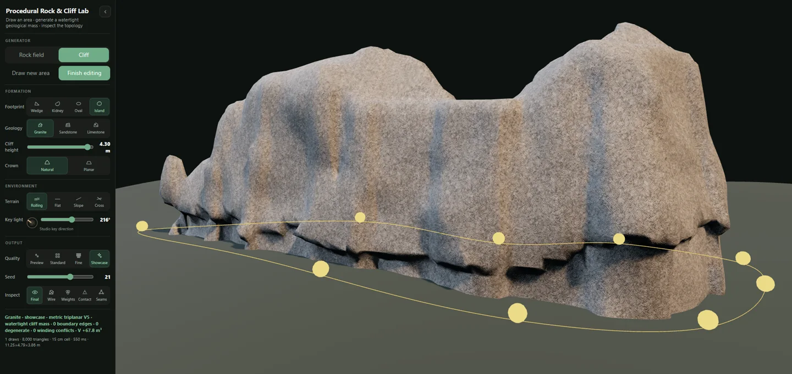
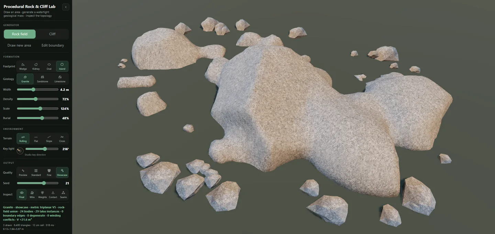

# Procedural Rock & Cliff Lab

An interactive Three.js demonstrator for drawing terrain-bound rock fields and watertight cliff masses. An editable footprint becomes a deterministic geological scalar field, one connected surface, a topology audit, and a metric triplanar PBR material.

This is a focused technical demo rather than a complete terrain editor. It makes the difficult part inspectable: believable fused stone masses that remain closed, deterministic, terrain-aware, and responsive enough for interactive authoring.

## 🚀 Live demo

[](https://maxliebscher.github.io/threejs-procedural-rocks-cliffs/)

The demo is static after its Vite build and runs directly on GitHub Pages. Vercel or a custom server is not required.

`.github/workflows/deploy-pages.yml` tests, builds, and publishes `dist/`. The Vite base path is relative, so all assets resolve correctly at the current project URL.

Opening the source `index.html` directly from `raw.githubusercontent.com` or `file://` is not supported: the source uses npm modules and must be bundled first.

## Demo video

https://github.com/user-attachments/assets/a4e22e55-1b61-4ca7-b3d3-159cf1e2d00f

## Showcase

### Procedural cliff



### Procedural rock field



## Run locally

Requirements: Node.js 20 or newer and a browser with WebGL 2.

```bash
npm install
npm run dev
```

Open `http://127.0.0.1:8791/`.

```bash
npm test       # topology + worker parity/cancellation regressions
npm run build  # production build in dist/
npm run test:build # build + bundled worker/Pages-path smoke test
npm run benchmark:worker # CPU event-loop comparison (Node; not browser latency)
npm run preview
```

## What to try

- Switch between **Rock field** and **Cliff**.
- Draw a new area, click a generated mesh to edit it, and drag the boundary handles.
- Click outside the mesh to leave edit mode.
- Compare Granite, Sandstone, and Limestone. They use different form grammars, not merely different textures.
- Move the studio key light with the slider; the compact menu dial shows its direction without covering the scene.
- Inspect the final material, wireframe, triplanar weights, ground contact, and topology seams.
- Watch boundary edges, degenerate triangles, winding conflicts, signed volume, triangles, cell size, draw calls, bounds, and build time update live.

## Pipeline

```text
editable footprint + terrain samples
  -> semantic placement plan
  -> deterministic geology-specific scalar causes
  -> terrain-aware SDF primitives and smooth union
  -> protected finite extraction lattice
  -> shared-edge Marching Tetrahedra
  -> gradient-oriented faces
  -> sliver collapse + volume-preserving smoothing
  -> guarded QEM reduction
  -> topology audit
  -> metric triplanar PBR
```

### Why an implicit field

Independent rock meshes intersect internally and explicit profile lofts tend to create seams, self-intersections, or cut-block silhouettes when many natural masses must fuse. This demo represents the main geological body as one continuous scalar field and extracts a single surface from the union.

Talus remains instanced only where separate debris is structurally appropriate.

### Geological form grammars

The presets share an extraction pipeline but not a generic displacement recipe:

- **Granite** uses broad lobes, restrained joints, and rounded weathering.
- **Sandstone** uses persistent bedding, banks, and controlled undercuts.
- **Limestone** uses block structure, dissolution pockets, and continuous fracture distances rather than discontinuous Voronoi cell IDs.

Macro silhouette, crown, walls, erosion, roughness, and normal response are derived from related causes at different scales so the material does not look detached from the geometry.

### Watertight extraction

- One consistent cube-to-tetrahedra decomposition.
- Intersection vertices cached by lattice edge.
- Outer lattice shell forced outside the field so the surface closes.
- Face orientation derived from the local field gradient.
- Sliver removal and volume-preserving smoothing before guarded simplification.

Every main mass is audited for:

```text
boundaryEdges = 0
degenerateTriangles = 0
windingConflicts = 0
signedVolume is non-trivial and consistently oriented
```

### Metric triplanar PBR

Materials are projected in world units instead of relying on generated UVs. The shader blends projections by surface normal and samples dedicated albedo, OpenGL normal, and roughness maps for each geology. This keeps texture scale stable while the generated shape, dimensions, and orientation change.

### Terrain contact

The planner samples the terrain for every semantic member and records its burial depth. The compiler rebuilds member bases from the current terrain and produces a sampled transition band. Normal editing hides the diagnostic transition surface; contact and topology inspection can reveal it.

Burial is supported from 14% through 69%, with 48% as the default.

### Progressive quality

Quality tiers separate field resolution from the final triangle budget:

| Tier | Extraction cell | Triangle target | Intended use |
| --- | ---: | ---: | --- |
| Preview | 30 cm | 3,200 | Interactive editing |
| Standard | 20 cm | 4,500 | General review |
| Fine | 17 cm | 6,500 | Close inspection |
| Showcase | 15 cm | 8,000 | Final presentation |

Higher tiers first display Preview, retain the same semantic plan and seed, and then atomically replace it with the refined surface. Final refinement runs in a module Web Worker after the existing 600 ms quiet period. Each input immediately invalidates the generation and terminates active refinement, including during the preview debounce window. A worker identity check and generation token also discard late results. The previous mesh stays visible until the replacement is ready.

The worker receives a plain semantic plan, terrain-mode name, and numeric/string options. It returns transferable position, normal, index, and instance-matrix arrays plus audit and display metadata. No materials, textures, renderer, or callbacks cross the boundary. The same compiler runs in both paths: Three.js in the worker is used only for CPU geometry and transforms, with no WebGL context. Analytic terrain formulas are shared, preserving exact heights instead of approximating them with samples.

If worker startup, loading, or compilation fails, the preview remains usable and the status reports the failure. There is deliberately no blocking synchronous high-quality fallback. A later edit retries refinement.

## Architecture and reuse

The core is split deliberately:

- `src/landscaping-planner.js` — semantic intent, deterministic placement, terrain samples, member dimensions, and diagnostics.
- `src/landscaping-field.js` — renderer-independent scalar-field extraction and mesh processing.
- `src/landscaping-compiler.js` — geological grammars, SDF assembly, terrain contact, reduction, topology audit, and Three.js buffers.
- `src/landscaping-worker.js` — CPU-only compiler entry and transferable results.
- `src/refinement-worker.js` — one active refinement, hard cancellation, stale-message and error handling.
- `src/landscaping-transfer.js` — explicit geometry wire format and main-thread reconstruction using existing materials.
- `src/landscaping-terrain.js` — shared analytic demo terrain functions.
- `src/landscaping-materials.js` — metric triplanar materials and debug visualization.
- `index.html` — standalone editor, studio scene, interaction, progressive quality, and live metrics.

Three.js is passed into the compiler rather than imported by the field core, which keeps geometry tests independent from WebGL.

## Performance notes

- Deterministic seeds make comparisons and bug reports reproducible.
- Expensive refinement never removes the currently visible mesh before its replacement exists.
- Main masses compile to one draw call; separate talus uses instancing.
- The directional shadow frustum is intentionally tight for useful contact resolution at a 1024² shadow budget.
- The terrain surface uses one calm color field in the studio view to avoid procedural blotching competing with the rocks.
- The key-light direction is visualized inside the menu so the showcase scene remains free of editor overlays.

### Verification and measured scope (15 October 2026)

`npm test` retains the original topology smoke cases and adds 24 real worker/compiler comparisons (two presets × three geologies × four quality tiers), covering all four terrain modes and changed seeds. Positions, normals, indices, instance transforms, user data and non-timing metrics match exactly. Tests also cover overlapping requests, explicit cancellation, deterministic repeats, late messages/errors, worker errors and recovery, startup failure, and clone failure. Browser worker globals are adapted to Node `worker_threads`; the actual production worker handler is executed.

`npm run test:build` serves `dist/` under `/threejs-procedural-rocks-cliffs/`, verifies relative entry/worker URLs, JavaScript MIME and material-manifest availability, and executes the emitted worker bundle with a closed-mesh topology check. PR CI runs both commands on Node 20. Pages still deploys only from `main` or manual dispatch and now performs this additional smoke check before uploading `dist/`. The existing public demo returned HTTP 200 during this review; the new code is not live until merged/deployed.

A five-run Linux/Node 24.19.0 CPU comparison (`npm run benchmark:worker`, 8 × 4 m limestone cliff, 3.5 m height, Showcase, seed 7) measured the largest gap between nominal 5 ms main-thread timer ticks:

| Measurement | Synchronous compiler | Worker compiler |
| --- | ---: | ---: |
| Median largest timer gap per run | 2,655.1 ms | 7.9 ms |
| Range of largest timer gaps | 2,341.6–2,950.5 ms | 6.4–24.9 ms |
| Median request completion time | 2,650.8 ms | 2,711.7 ms |

This demonstrates CPU event-loop availability during extraction, **not browser input latency, render FPS, or faster geometry computation**. Worker timing includes startup and transfer; the benchmark excludes preview, debounce, main-thread reconstruction, terrain rebuilding and rendering. Runtime/hardware/load affect these numbers; they are observational, not CI thresholds. Browser/WebGL visual and interaction QA could not be completed in this environment: Chromium download returned a non-ZIP response and the cloud browser could not reach the local server. Cross-browser/mobile behavior and a deployment of this branch remain unverified.

## Known boundaries

- The low-resolution preview, semantic planning, terrain/editor helpers, GPU upload, and rendering still run on the main thread and can pause input. Moving refinement does not promise a fixed frame rate or zero input latency.
- Module workers require HTTP(S) and worker-compatible CSP. Each refinement starts a fresh worker (startup/JIT overhead); the current production worker bundle is about 152 kB uncompressed. The main bundle still triggers Vite's 500 kB advisory.
- Only the demo's four analytic terrain modes are serialized. Reuse with arbitrary terrain callbacks needs an explicit shared terrain representation.
- The included terrain transition is a demo solution; a production terrain system should derive its cut from the same final front field or compiled contour.
- This is not a general-purpose voxel editor, erosion simulator, or terrain authoring suite.
- Large worlds need chunking, LOD, and a scalable shadow strategy beyond this focused demo.

## Codex skill

`codex-skill/procedural-rocks-cliffs/` contains the portable Codex skill and its technical reference. Copy that folder into a Codex skills directory and invoke `$procedural-rocks-cliffs` when building or reviewing procedural rock fields, cliffs, or terrain-bound stone masses.

## Credits

Created by **Max Liebscher** with **OpenAI Codex (Sol)** and **Claude Fable**. Rock material details are documented in `public/assets/rock-materials/SOURCE.md`.

## Release status and license

Released under the [MIT License](LICENSE). Copyright © 2026 Max Liebscher.

This is the standalone public release of the Procedural Rock & Cliff Lab.
